# Identity & Access Management: Joiner-Mover-Leaver (JML) Standard Operating Procedure

**Framework Standards:** ISO/IEC 27001:2022 (A.5.15, A.5.18, A.6.5), SOC 2 CC6.2, CC6.3, CC6.4  
**Author:** Vrunda Dalsaniya (Information Security / GRC)  
**Classification:** Internal Operational Procedure  

---

## 1. Overview & Objective

The Joiner-Mover-Leaver (JML) framework defines the end-to-end lifecycle of identity management within the enterprise. The objective is to enforce the **Principle of Least Privilege (PoLP)**, prevent **privilege creep**, and guarantee rapid, audit-compliant deprovisioning upon employee departure.

```mermaid
flowchart TD
    subgraph Joiner ["1. Joiner (Onboarding)"]
        J1["HR creates employee profile in HRIS"] --> J2["Automated provisioning via IdP / SCIM"]
        J2 --> J3["Default role-based group assignment (RBAC)"]
        J3 --> J4["Manager approval required for elevated access"]
    end

    subgraph Mover ["2. Mover (Role Transfer)"]
        M1["Internal promotion or transfer logged in HRIS"] --> M2["Trigger 'Revoke & Re-approve' review"]
        M2 --> M3["Immediate revocation of previous departmental access"]
        M3 --> M4["Assignment of new role profile with managerial sign-off"]
    end

    subgraph Leaver ["3. Leaver (Offboarding)"]
        L1["HR enters termination date in HRIS"] --> L2{"Notice Type"}
        L2 -->|"Involuntary"| L3["Instant immediate account freeze (0 min)"]
        L2 -->|"Voluntary"| L4["Scheduled deactivation at end of final shift (<4 hrs)"]
        L3 & L4 --> L5["Session kill, OAuth token revocation, hardware wipe"]
        L5 --> L6["Archive mailbox & cloud drives (30-day retention)"]
    end
```

---

## 2. Phase 1: Joiner Process (Onboarding)

### 2.1 Principles
- No user is granted access without a formal HR profile and background verification.
- Access is strictly assigned via Role-Based Access Control (RBAC) profiles. No ad-hoc individual permissions.

### 2.2 Standard Workflow
1. **Trigger:** HR inputs confirmed hire details into HRIS at least 3 business days prior to start date.
2. **Birthright Provisioning:** Automated SCIM sync provisions:
   - Corporate Email & SSO account (Okta / Google Workspace).
   - Core productivity tools (Slack, Jira, Google Docs) with standard user rights.
   - Enforced MFA enrollment on first login using temporary one-time bypass code.
3. **Elevated Access:** If specialized access is required (e.g., GitHub, AWS sandbox), the hiring manager must submit an explicit ticket with business justification.
4. **Audit Trail:** All provisioning actions generate immutable audit logs stored in the SIEM for 365 days.

---

## 3. Phase 2: Mover Process (Role Transition)

### 3.1 Principles
- Privilege creep is a major risk where transferring employees accumulate access from previous roles.
- The organization enforces a **"Clean Slate / Re-certify"** policy.

### 3.2 Standard Workflow
1. **Trigger:** HR updates department, reporting manager, or job title in HRIS.
2. **Automated Access Reset:**
   - Identity Provider initiates a diff review between previous and new RBAC roles.
   - Permissions tied to the previous department are automatically scheduled for removal within 48 hours.
3. **Re-certification:** The new hiring manager reviews and formally approves the required permissions for the new role.
4. **Separation of Duties (SoD) Check:** An automated check verifies that the new permissions do not violate SoD matrices (e.g., code deployment rights cannot be combined with production database finance ledger access).

---

## 4. Phase 3: Leaver Process (Offboarding)

### 4.1 Service Level Agreements (SLAs)

| Departure Type | Target Suspension SLA | Hardware Recovery SLA | Final Deprovisioning SLA |
| :--- | :---: | :---: | :---: |
| **Involuntary Termination** | **Immediate (< 15 mins)** | Day of termination | 24 Hours |
| **Voluntary Resignation** | **< 4 Hours** from shift end | Within 48 hours | 24 Hours |

### 4.2 Step-by-Step Deprovisioning Checklist
1. **Identity Provider Action:**
   - Set account status to `SUSPENDED`.
   - Invalidate all active browser sessions and OAuth refresh tokens (`Revoke All Sessions`).
   - Reset user password to a cryptographically random 32-character string.
2. **Cloud & Production Access:**
   - Invalidate AWS IAM credentials, SSH public keys, and GitHub enterprise seat.
   - Remove VPN certificates and disable RADIUS authentication.
3. **Endpoint & Physical Security:**
   - Send MDM (Jamf / Intune) remote lock and wipe command to corporate mobile devices/laptops.
   - Deactivate RFID physical access badge and revoke building access privileges.
4. **Evidence Archival:**
   - Complete Leaver Sign-off sheet; attach timestamped IdP deactivation log to Jira offboarding ticket.

---

## 5. Quarterly User Access Reviews (UAR)

To catch deviations or anomalies, the GRC team conducts mandatory quarterly reviews:
- Department managers receive an export of all team members and their associated entitlements.
- Managers must review each entitlement and choose: **Affirm** or **Revoke**.
- Unresponded reviews after 14 days are escalated directly to the CISO, with unconfirmed privileges automatically suspended.
