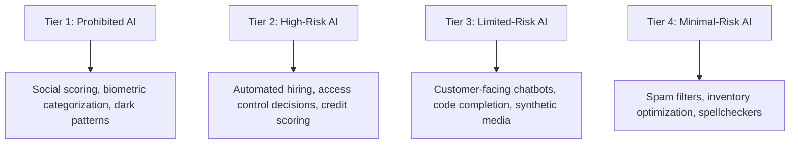

# Artificial Intelligence (AI) Acceptable Use & Governance Policy

**Policy Reference:** POL-AIMS-001  
**Standard Alignment:** ISO/IEC 42001:2023 (Artificial Intelligence Management System), EU AI Act, NIST AI RMF  
**Author:** Vrunda Dalsaniya (ISO/IEC 42001 Lead Auditor, GRC Analyst)  
**Effective Date:** October 2026  
**Classification:** Enterprise Policy  

---

## 1. Purpose & Scope

The emergence of Generative AI, Large Language Models (LLMs), and autonomous agentic workflows presents unprecedented business opportunities alongside significant security, privacy, intellectual property, and ethical risks.

This policy establishes mandatory guidelines for the responsible, compliant, and secure evaluation, adoption, and daily utilization of Artificial Intelligence (AI) tools, services, and libraries across the enterprise.

This policy applies to all personnel, contractors, software engineers, and automated data processing pipelines.

---

## 2. AI Risk Categorization

The organization categorizes AI applications into four distinct risk tiers:

| Tier Level | Definition & Criteria | Approval / Controls Required |
| :--- | :--- | :--- |
| **Tier 1: Prohibited** | AI practices that violate fundamental privacy rights or introduce unacceptable risk. | **Strictly Prohibited.** No exceptions. |
| **Tier 2: High-Risk** | AI systems influencing employment, legal status, safety-critical systems, or medical decisions. | Mandatory AI Impact Assessment (AIIA), algorithmic bias audit, and CISO / Legal sign-off. |
| **Tier 3: Limited-Risk** | Generative AI chatbots, internal coding assistants, and automated summarizers. | Transparency disclosures (notifying users they interact with AI), enterprise zero-retention agreements. |
| **Tier 4: Minimal-Risk** | AI features embedded in standard enterprise productivity tools (e.g. search ranking, grammar tools). | Standard IT approval via software procurement process. |

---

## 3. Acceptable Use Guidelines

### 3.1 Prohibited Data Inputs (Zero Data Leakage)
Employees are strictly prohibited from submitting, pasting, or feeding the following information into public or consumer-tier AI systems (e.g., free ChatGPT, consumer Claude, Midjourney):
- **Proprietary Source Code:** Internal repositories, algorithmic intellectual property, or confidential API keys.
- **Customer Confidential Information & PII:** Names, email addresses, government IDs, financial records, or medical information.
- **Corporate Financial & Strategic Data:** Unreleased earnings, M&A strategy, customer contract terms, or security vulnerability reports.

### 3.2 Approved Enterprise AI Tools
- Personnel may only utilize AI tools that operate under an **Enterprise Agreement** explicitly guaranteeing:
  1. Customer inputs and prompts are **NOT used to train or fine-tune** foundational models.
  2. Data is encrypted in transit (TLS 1.3) and at rest (AES-256).
  3. SOC 2 Type II or ISO 27001 compliance certification is maintained by the vendor.

### 3.3 Human-in-the-Loop & Verification
- AI-generated outputs (including source code, compliance documents, or customer communications) must never be deployed into production without rigorous **human review and verification**.
- Engineers using AI coding assistants are personally responsible for verifying code correctness, dependency safety, and vulnerability avoidance (e.g., ensuring no SQL injection or hallucinated insecure libraries are introduced).

---

## 4. AI Vendor Risk Assessment & Continuous Monitoring

Prior to onboarding any third-party AI service or API:
1. The GRC team conducts a **Third-Party AI Risk Assessment** evaluating:
   - Data retention and zero-day training policies.
   - Guardrails against prompt injection and jailbreaking.
   - System transparency, model explainability, and copyright indemnification.
2. AI-driven system decisions must be logged and auditable to meet regulatory traceability obligations.

---

## 5. Incident Reporting

If an employee suspects that confidential corporate data or PII was accidentally submitted to an unsanctioned or public AI platform:
- They must report the incident to `security@company.com` within **1 hour**.
- The security team will initiate token/credential revocation and contact the platform provider to request immediate cache purging.
