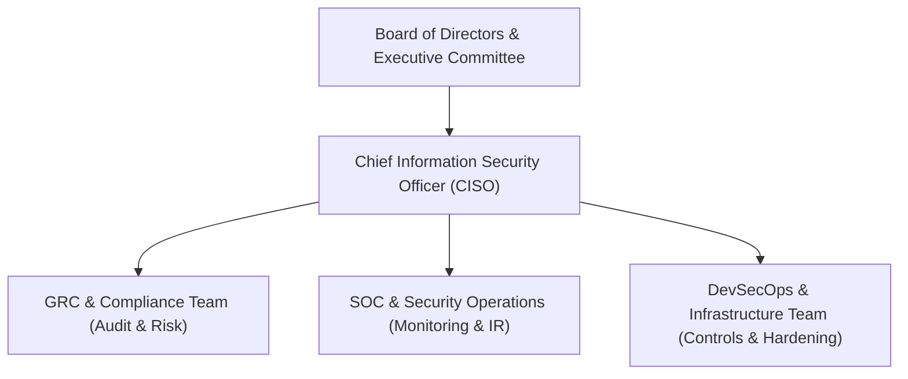

# Enterprise Information Security Policy

**Policy Reference:** POL-ISMS-001  
**ISO/IEC 27001:2022 Reference:** Clause 5.2 (Policy), Clause 6.2 (Objectives)  
**Author:** Vrunda Dalsaniya (Information Security & GRC)  
**Effective Date:** October 2026  
**Classification:** Public / Enterprise Standard  

---

## 1. Vision & Executive Commitment

Information security is vital to maintaining customer trust, regulatory compliance, and business continuity. Senior Executive Leadership is committed to developing, implementing, operating, monitoring, reviewing, and continuously improving the **Information Security Management System (ISMS)** in alignment with **ISO/IEC 27001:2022** and **SOC 2 Type II** criteria.

---

## 2. Core Information Security Objectives

The organization establishes and monitors specific, measurable information security objectives:
1. **Confidentiality:** Protect proprietary code, customer intellectual property, and personally identifiable information (PII) from unauthorized disclosure.
2. **Integrity:** Ensure the authenticity, accuracy, and completeness of all production data and business transaction records.
3. **Availability:** Maintain high-availability systems with an annual uptime SLA of $\ge 99.9\%$, backed by verified disaster recovery and business continuity plans.
4. **Compliance:** Ensure 100% adherence to all statutory, contractual, and regulatory requirements (e.g., GDPR, India DPDP Act 2023, SOC 2, ISO 27001).

---

## 3. Governance Structure & Roles

- **Executive Management:** Provides resources, strategy, and overall accountability for information security risk posture.
- **GRC Team:** Conducts risk assessments, orchestrates internal audits, maintains the risk register, and drafts compliance documentation.
- **System & Data Owners:** Responsible for day-to-day classification, access approvals, and vulnerability remediation across their respective domains.
- **All Employees & Contractors:** Responsible for adhering to security policies, completing security awareness training, and reporting suspected incidents immediately.

---

## 4. Fundamental Security Tenets

1. **Risk Management:** Risk assessments must be conducted at least annually, or following significant architectural, infrastructure, or operational changes.
2. **Asset Management:** All hardware, software, cloud instances, and data repositories must be inventoried and assigned a designated asset custodian.
3. **Secure by Design:** Security requirements must be embedded throughout all phases of the Software Development Life Cycle (SDLC).
4. **Incident Response:** Any security anomaly or suspected breach must be escalated to `security@company.com` within 15 minutes of discovery.
5. **Continuous Improvement:** Findings from audits, vulnerability assessments, and incident post-mortems must be tracked in the CAPA register until verified and closed.

---

## 5. Disciplinary Actions & Compliance

Adherence to this policy is mandatory. Any willful breach of security policies will result in disciplinary action up to termination of employment and may involve statutory reporting.
