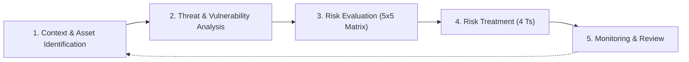

# Information Security Risk Assessment Methodology

**Standard Alignment:** ISO/IEC 27001:2022 (Clause 6.1.2 & 6.1.3), ISO/IEC 27005:2022  
**Document Owner:** Vrunda Dalsaniya (Information Security & GRC)  
**Version:** 1.0  
**Classification:** Internal  

---

## 1. Purpose & Scope

The purpose of this Risk Assessment Methodology is to provide a standardized, repeatable, and objective framework for identifying, analyzing, evaluating, and treating information security risks across organizational assets, systems, and processes.

This methodology covers all information assets, technology infrastructure, cloud environments, human resources, and third-party vendors within the scope of the Information Security Management System (ISMS).

---

## 2. Risk Assessment Process

The organization follows a four-stage risk management lifecycle:

---

## 3. Qualitative Risk Scoring Criteria

Risks are evaluated using a **5×5 qualitative matrix** combining **Likelihood** and **Impact**.

$$\text{Risk Score} = \text{Likelihood Rating} \times \text{Impact Rating}$$

### 3.1 Likelihood Criteria (1 to 5)

| Level | Rating | Frequency / Probability | Operational Description |
| :---: | :--- | :--- | :--- |
| **1** | Rare | Less than once every 3 years | Highly improbable; requires extraordinary conditions or specialized insider capability. |
| **2** | Unlikely | Once every 1 to 3 years | Low probability; known vulnerability with no public exploit, or strong baseline controls exist. |
| **3** | Possible | Once a year | Moderate probability; exploit exists or standard human error / phishing occurrence. |
| **4** | Likely | Multiple times per year | High probability; targeted attack vector, missing key controls, or frequent audit deficiency. |
| **5** | Almost Certain | Monthly or continuous | Actively exploited in the wild, zero mitigation in place, or recurring incident. |

### 3.2 Impact Criteria (1 to 5)

| Level | Rating | Financial Impact | Operational / Service Impact | Regulatory & Legal Impact | Reputation Impact |
| :---: | :--- | :--- | :--- | :--- | :--- |
| **1** | Insignificant | < $5,000 | Negligible downtime (< 1 hour); no impact on business deliverables. | No regulatory breach. | No media coverage; internal awareness only. |
| **2** | Minor | $5,000 – $25,000 | Brief disruption (1 – 4 hours); service degraded but recoverable. | Minor non-compliance with internal policy. | Minor customer dissatisfaction resolved informally. |
| **3** | Moderate | $25,000 – $100,000 | Moderate disruption (4 – 24 hours); partial loss of critical system. | Reportable SLA breach; potential minor regulatory query. | Local or industry-specific negative press; churn risk. |
| **4** | Major | $100,000 – $500,000 | Major disruption (1 – 3 days); core revenue operations halted. | Material breach of GDPR/HIPAA/DPDP; regulatory investigation and fines. | Widespread regional media coverage; executive accountability. |
| **5** | Catastrophic | > $500,000 | Catastrophic outage (> 3 days); irreversible data loss or system corruption. | Revocation of operating licenses; severe statutory sanctions and litigation. | Global reputational fallout; permanent loss of client trust. |

---

## 4. Risk Evaluation Matrix (5×5)

| Likelihood \ Impact | 1 - Insignificant | 2 - Minor | 3 - Moderate | 4 - Major | 5 - Catastrophic |
| :--- | :---: | :---: | :---: | :---: | :---: |
| **5 - Almost Certain** | 5 (Medium) | 10 (High) | 15 (High) | 20 (Critical) | 25 (Critical) |
| **4 - Likely** | 4 (Low) | 8 (Medium) | 12 (High) | 16 (High) | 20 (Critical) |
| **3 - Possible** | 3 (Low) | 6 (Medium) | 9 (Medium) | 12 (High) | 15 (High) |
| **2 - Unlikely** | 2 (Low) | 4 (Low) | 6 (Medium) | 8 (Medium) | 10 (High) |
| **1 - Rare** | 1 (Low) | 2 (Low) | 3 (Low) | 4 (Low) | 5 (Medium) |

---

## 5. Risk Acceptance Thresholds & Action SLAs

| Score Range | Severity Level | Action Required & SLA | Escalation / Sign-off |
| :---: | :---: | :--- | :--- |
| **17 – 25** | 🔴 **Critical** | Immediate mitigation plan required within **7 days**. Workarounds or interim containment within **24 hours**. | CISO / Board Approval |
| **10 – 16** | 🟠 **High** | Action plan must be executed within **30 days**. Continuous monitoring and secondary controls assigned. | CISO / Security Director |
| **5 – 9** | 🟡 **Medium** | Remediation scheduled in the standard release cycle or within **90 days**. | Head of IT / Business Owner |
| **1 – 4** | 🟢 **Low** | Accept risk with periodic annual review; monitor for contextual changes. | System Owner |

---

## 6. Risk Treatment Options (The 4 Ts)

When a risk exceeds the organizational risk tolerance threshold (Score > 8), one of the following treatments must be selected:

1. **Treat (Mitigate):** Implement specific technical, organizational, or physical controls (mapped to ISO 27001:2022 Annex A) to reduce likelihood or impact.
2. **Transfer (Share):** Shift financial or operational liability to a third party (e.g., cyber insurance, outsourcing with indemnification clauses).
3. **Tolerate (Accept):** Formally acknowledge and accept residual risk if remediation cost outweighs potential impact (requires executive justification).
4. **Terminate (Avoid):** Discontinue the risky process, system, feature, or third-party partnership altogether.
